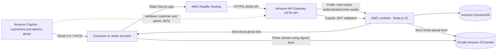

# CivicSignal

CivicSignal is a community issue reporter backed by AWS. Customers create an account or sign in through Amazon Cognito before submitting reports; the public board remains open to everyone. Administrators use a separate staff page and must belong to the Cognito `admins` group before changing report status. The application does not fall back to sample reports or browser-only storage when the AWS API is missing; it shows a clear setup error instead.

## Architecture



The frontend is a Next.js static export. Amplify serves the generated `.next-build/` directory; the browser calls the API directly. Each API request runs independently through API Gateway and an asynchronous Lambda handler. Lambda validates each report, stores its data in on-demand DynamoDB, and creates short-lived S3 upload and photo links. S3 blocks public access. API Gateway requires a Cognito JWT for report creation, photo uploads, and status changes; Lambda also checks `admins` membership before status changes. New accounts are customers by default and cannot grant themselves administrator access.

## Live deployment

- Website: [https://main.d12mlhq3wpzmgb.amplifyapp.com/](https://main.d12mlhq3wpzmgb.amplifyapp.com/)
- AWS region: `ap-southeast-2`; SAM stack: `civicsignal`.
- The public report API, DynamoDB table, private photo bucket, and Cognito sign-in are deployed.
- The Cognito user pool currently has no administrator accounts. Create a user in the user pool and add it to the `admins` group before testing status updates.

## What is included

- Public report submission with category, description, street or landmark, optional browser coordinates, and an optional photo.
- Report browsing, text search, category and status filters, a detail view, and pagination.
- An administrator dashboard for moving reports through **Reported**, **In progress**, and **Resolved**.
- Cognito customer sign-up, email confirmation, sign-in, and sign-out using the authorization-code flow with PKCE.
- A separate staff sign-in and dashboard; only accounts added to the Cognito `admins` group can change report status.
- Authenticated report creation and photo upload, with the authenticated Cognito subject stored privately on each report.
- AWS SAM infrastructure for the API, DynamoDB, private S3 storage, Cognito user pool, and admin group.
- Recovery messages for network failures, invalid requests, expired admin sessions, rejected photo uploads, and server errors.

## Install and configure

Requires Node.js 20 or newer and npm.

```powershell
npm install
Copy-Item .env.example .env.local
```

Deploy the AWS backend below and fill `.env.local` with its outputs before starting the application. The API is required; there is no fake or browser-only data mode.

```powershell
npm run dev
```

Open `http://localhost:3000`. The site is fully connected when the API and Cognito values are configured.

## Deploy the AWS backend

Install the AWS CLI and AWS SAM CLI, configure credentials for your AWS account, then run:

```powershell
npm install --prefix infra/src
cd infra
sam build
sam deploy --guided
```

During the guided deployment, set `FrontendOrigin` to `http://localhost:3000` for local development. Copy the resulting `ApiUrl`, `CognitoDomain`, and `UserPoolClientId` outputs into a root `.env.local` file:

```dotenv
NEXT_PUBLIC_API_BASE_URL=https://your-api-id.execute-api.your-region.amazonaws.com
NEXT_PUBLIC_COGNITO_DOMAIN=https://your-cognito-domain.auth.your-region.amazoncognito.com
NEXT_PUBLIC_COGNITO_CLIENT_ID=your-public-user-pool-client-id
NEXT_PUBLIC_COGNITO_REDIRECT_URI=http://localhost:3000/admin/callback/
```

Restart `npm run dev`. The same form and dashboard now use the AWS API instead of browser preview data.

## Host the website on AWS

1. Push the project to a Git repository and connect it to AWS Amplify Hosting. The included `amplify.yml` installs the locked packages, builds the static export, and publishes `.next-build/`.
2. Add the API URL, Cognito domain, and client ID outputs to Amplify’s environment variables. Set `NEXT_PUBLIC_COGNITO_REDIRECT_URI` to `https://YOUR-AMPLIFY-DOMAIN/admin/callback/`.
3. After Amplify gives you the site domain, update the SAM stack’s `FrontendOrigin` parameter to `https://YOUR-AMPLIFY-DOMAIN` (no trailing slash). This configures API and S3 CORS rules and Cognito’s callback/logout URLs. From the `infra` directory, run `sam deploy --parameter-overrides FrontendOrigin=https://YOUR-AMPLIFY-DOMAIN`.
4. Redeploy the Amplify branch so the public environment variables are included in the static build.
5. Customers can create their own accounts on `/account/`. To grant a staff member administrator access, use the Cognito console to add that account to the `admins` group. New self-registered users are customers and cannot add themselves to that group.

For a later domain change, update `FrontendOrigin`, the Amplify environment variables, and deploy both stack and frontend again.

## API routes

| Method | Route | Access | Purpose |
|---|---|---|---|
| `GET` | `/reports` | Public | List reports, with optional category/status filters and page token. |
| `GET` | `/reports/{reportId}` | Public | Read one report. |
| `POST` | `/reports` | Cognito customer or admin | Validate and create a report. |
| `POST` | `/uploads/presign` | Cognito customer or admin | Issue a short-lived, size-limited S3 photo upload form. |
| `PATCH` | `/reports/{reportId}` | Cognito `admins` group | Update a report’s status. |

Reports are public by design, so the form does not collect a reporter’s name, email, or phone number. The Cognito subject is stored privately for operational ownership and is removed from all public API responses. The optional coordinates require the visitor’s explicit browser permission. The first version uses the typed location label for search and links coordinates to OpenStreetMap; it does not call a paid geocoding or map API.

The frontend keeps customer and administrator access tokens in separate per-tab session storage. The API has no in-process user session state: Cognito validates each request independently, while Lambda and DynamoDB handle simultaneous requests through AWS-managed concurrency and on-demand capacity. Atomic DynamoDB rate limits apply per account (10 reports and 20 photo upload forms per hour), so customers sharing a network do not share one quota.

## Implementation notes

- DynamoDB uses on-demand billing and a `FeedIndex` for newest-first report browsing.
- S3 blocks public access and accepts only short-lived, size-limited JPG, PNG, or WebP uploads. Unsubmitted temporary uploads expire after one day.
- The frontend receives public Cognito settings only. AWS credentials and S3 permissions stay in the Lambda execution role.
- Use the supported Next.js version pinned in `package.json` when deploying to Amplify. The current Amplify Next.js support documentation lists versions through 15: [AWS Amplify Next.js support](https://docs.aws.amazon.com/amplify/latest/userguide/ssr-amplify-support.html).
- The Lambda uses AWS’s managed Node.js 22 runtime: [AWS Lambda Node.js runtimes](https://docs.aws.amazon.com/lambda/latest/dg/lambda-runtimes.html).
- Administrator login uses Cognito’s public-client authorization-code flow with PKCE: [Amazon Cognito PKCE guide](https://docs.aws.amazon.com/cognito/latest/developerguide/using-pkce-in-authorization-code.html). The token endpoint supports browser requests for this flow: [Cognito token endpoint](https://docs.aws.amazon.com/cognito/latest/developerguide/token-endpoint.html).
- The API Gateway stage applies request throttling. Before opening the public form to a large audience, add moderation and stronger abuse prevention.
